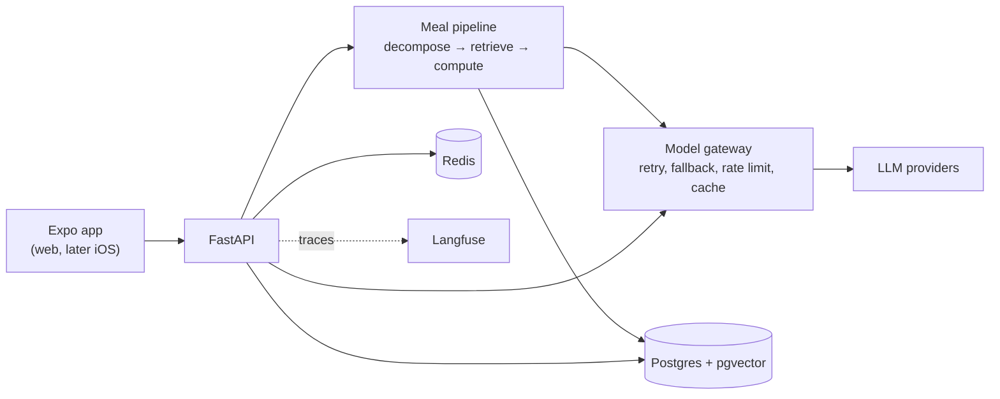

# PhysiqOS

PhysiqOS is a nutrition and training tracker with an AI coach. It estimates calories and macros from a meal photo or a short text description, sets calorie targets from body stats and goals, and tracks workout progression.

The project is also a worked example of running an LLM feature in production: evaluated against a labeled dataset, grounded in food databases, traced end to end, and deployed on AWS behind a CI eval gate.

**Status:** early development. The evaluation dataset and harness come first. See the [roadmap](docs/ROADMAP.md) for milestones and progress.

## Features (planned)

- Calorie and macro targets from height, weight, activity level and goal.
- Meal logging from a photo or from text such as "250g ức gà nấu chín" or "cơm tấm sườn bì chả". Vietnamese dishes are supported alongside English input.
- Workout plans, set logging and progression charts (estimated 1RM, volume, personal records).
- A coach that gives technique cues drawn from a curated library with cited sources.

## How calorie estimation works

Language models are good at reading a meal description or photo, and unreliable at recalling exact nutrition values. PhysiqOS splits the work accordingly:

1. The model breaks the meal into items with estimated portions in grams.
2. Each item is matched against USDA FoodData Central and the Vietnamese Food Composition Table using hybrid search (BM25 and embeddings) with a reranker.
3. Calories and macros are computed in code from the matched entries.

Changes to prompts, models or retrieval are measured against a versioned golden dataset before they ship. Metrics and ship thresholds are defined in the [eval spec](docs/eval-spec.md). User corrections to estimates are reviewed and added back to the dataset.

## Architecture



Infrastructure (planned): ECS Fargate, RDS, ECR, Secrets Manager and CloudWatch, provisioned with Terraform. GitHub Actions runs tests and the eval suite on every pull request and blocks merges that regress quality.

## Documentation

- [Roadmap](docs/ROADMAP.md): milestones, exit criteria and status
- [Eval spec](docs/eval-spec.md): task definition, metrics and ship criteria for calorie estimation

## Development

Requirements: Python 3.13 and [uv](https://docs.astral.sh/uv/).

```bash
cp .env.example .env
cd backend
uv sync
```

The backend is a skeleton for now. Data, eval and infrastructure directories are added as their milestones start.

## Project layout

```text
backend/    FastAPI service
docs/       roadmap and eval spec
.github/    pull request template
```

## Disclaimer

PhysiqOS provides general fitness and nutrition information. It is not a substitute for professional medical advice.
